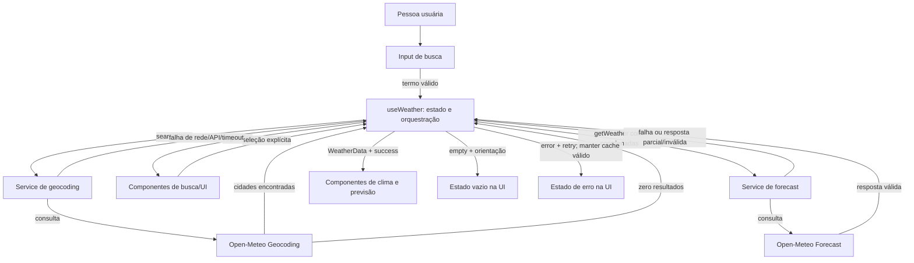

# Plano Técnico — Weather App

> **Fonte da verdade:** [Especificação do Weather App](../specs/weather-app-spec.md). Em caso de divergência, prevalecem seus RFs e critérios de aceite.
> **Escopo:** decisões e contratos para o MVP; não inclui implementação.

## Architecture

SPA React organizada em camadas, sem backend próprio:

```text
components (renderização e eventos)
      ↓
hooks (estado da tela e orquestração)
      ↓
services (HTTP Open-Meteo e localStorage)
      ↓                    ↓
Open-Meteo             navegador/localStorage

hooks/services → lib (funções puras) → types (contratos de domínio)
```

- **`components/` — apresentação:** recebe dados, estados e callbacks por props; renderiza interface acessível. Não importa `fetch`, `localStorage` nem controla políticas de retry/cache.
- **`hooks/` — aplicação:** coordena busca, seleção explícita, carregamento, retry, refresh, cache e descarte de respostas obsoletas; expõe estado e operações para os componentes. Não conhece detalhes de URL ou JSON do provedor.
- **`services/` — acesso a dados:** encapsula chamadas HTTP, timeout, status/erros, parsing de respostas e operações de persistência local. Converte falhas externas em erros tipados para o hook.
- **`lib/` — regras puras:** contém conversão de temperatura, formatação, normalização de termos e mapeamento WMO. Funções recebem valores e retornam valores, sem rede, armazenamento ou estado React.
- **`types/` — contratos:** define modelos de domínio compartilhados, sem dependência de React ou de componentes.

Dependências permitidas seguem uma direção única: componentes → hooks → services/lib → types. `lib/` não importa `services/`, hooks ou React. Isso permite testar cada camada com fronteiras pequenas: componentes com props/callbacks, hooks com serviços mockados, serviços com `fetch`/storage simulados e funções de `lib/` com testes unitários sem mocks de IO.

## Tech Stack

| Área | Decisão | Justificativa |
|---|---|---|
| Aplicação | React 19, TypeScript strict e Vite | Stack existente e apropriada para SPA responsiva. |
| Interface | Tailwind CSS | Já configurado; atende ao tema e aos breakpoints do produto. |
| Dados remotos | `fetch` nativo e Open-Meteo | Sem chave de API e sem dependência de cliente HTTP no MVP. |
| Estado | React `useState`/hooks locais | Um fluxo principal e uma cidade por vez não justificam store global. |
| Persistência | `localStorage` | Atende à persistência local e ao cache requerido sem serviço de backend. Falhas de armazenamento não bloqueiam a sessão. |
| Testes | Vitest, Testing Library e Playwright | Ferramentas já instaladas; cobrem lógica, interface e fluxo de usuário. |
| Qualidade | Biome e pnpm | Convenções e scripts existentes do repositório. |

Não adicionar dependências de runtime para estado, cache ou requisições sem necessidade demonstrada.

## Project Structure

Manter os arquivos atuais e explicitar a responsabilidade de cada camada. `storageService.ts` é o único módulo novo necessário para isolar a persistência requerida por RF08.

```text
src/
  App.tsx                       Composição da tela e ligação do hook aos componentes
  main.tsx                      Inicialização React
  components/
    SearchBar.tsx               Entrada e lista de sugestões; emite busca/seleção
    CurrentWeather.tsx          Apresenta clima atual
    ForecastList.tsx             Apresenta a previsão diária
    ForecastCard.tsx             Apresenta um dia da previsão
    UnitToggle.tsx               Emite a unidade escolhida
    states/
      EmptyState.tsx             Estado vazio
      ErrorState.tsx             Mensagem e ação de retry
      LoadingState.tsx           Estado de carregamento
  hooks/
    useWeather.ts                Estado e orquestração dos fluxos
  services/
    weatherService.ts            Geocoding, forecast, timeout e erros de API
    storageService.ts             Leitura/escrita de preferências e cache local
  lib/
    format.ts                    Formatação pt-BR de datas e valores
    temperature.ts               Conversão/apresentação Celsius e Fahrenheit
    weatherCodes.ts               Mapeamento puro de códigos WMO
    searchQuery.ts                Normalização/validação pura do termo de busca
  types/
    weather.ts                   Unit, City, CurrentWeather, ForecastDay e WeatherData
  styles/
    index.css                     Estilos globais e tema
tests/
  unit/                           Testes unitários e de componentes
  e2e/                            Fluxos completos com APIs interceptadas
```

Não criar subpastas por feature, clientes genéricos ou camada de repositório adicional: a separação acima é suficiente para uma cidade por vez e dois serviços de dados. Testes espelham as fronteiras, não a estrutura interna de cada componente.

## Data Model

Temperaturas ficam normalizadas em Celsius; conversão para Fahrenheit ocorre somente na apresentação. Respostas da API são validadas e mapeadas antes de entrar no estado ou cache.

```ts
/** Unidade de temperatura selecionada para apresentação. */
type Unit = 'celsius' | 'fahrenheit';

interface City {
  /** Identificador da localidade retornado pelo geocoding. */
  id: number;
  /** Nome da cidade retornado pela busca. */
  name: string;
  /** País da cidade, quando fornecido pelo geocoding. */
  country?: string;
  /** Região administrativa, quando fornecida pelo geocoding. */
  admin1?: string;
  /** Latitude usada na consulta de forecast. */
  latitude: number;
  /** Longitude usada na consulta de forecast. */
  longitude: number;
}

interface CurrentWeather {
  /** Temperatura atual normalizada em Celsius. */
  temperatureC: number | null;
  /** Código WMO da condição atual. */
  weatherCode: number | null;
  /** Horário de referência atual retornado pela API no fuso da cidade. */
  referenceTime: string | null;
}

interface ForecastDay {
  /** Data civil retornada para o fuso da cidade, no formato YYYY-MM-DD. */
  date: string;
  /** Temperatura mínima do dia normalizada em Celsius. */
  minC: number | null;
  /** Temperatura máxima do dia normalizada em Celsius. */
  maxC: number | null;
  /** Código WMO da condição diária fornecida pela API. */
  weatherCode: number | null;
}

interface WeatherData {
  /** Cidade selecionada para a consulta. */
  city: City;
  /** Fuso horário da cidade retornado pelo forecast. */
  timezone: string | null;
  /** Condições atuais retornadas pela API. */
  current: CurrentWeather;
  /** Cinco dias consecutivos validados, incluindo hoje na cidade. */
  forecast: ForecastDay[];
  /** Instante UTC em que a aplicação recebeu os dados, para controle do cache. */
  retrievedAt: string;
}
```

`weatherCode` é mapeado pela tabela WMO da especificação; código desconhecido usa condição indisponível e ícone neutro. Os tipos de domínio não incluem umidade, vento, pressão ou precipitação, fora dos dados exibidos no MVP. Cache de busca é indexado pelo termo normalizado; cache de clima, pelas coordenadas da cidade. Cache incompleto/inválido não é persistido como resposta válida.

## Data Flow



1. Ao digitar, remover espaços externos e exigir dois ou mais caracteres. Aguardar 300 ms após a última alteração antes da busca; codificar o texto como parâmetro de URL e preservar caracteres Unicode válidos.
2. Consultar geocoding, validar e mapear até 10 cidades. Resultado vazio gera estado vazio, não erro. Nunca selecionar resultado automaticamente.
3. Ao selecionar explicitamente uma cidade, consultar forecast com suas coordenadas. Não permitir que uma resposta de consulta anterior substitua a busca ou cidade atualmente ativa.
4. Validar o contrato do forecast: datas válidas e consecutivas e vetores com cinco posições alinhadas. Valores meteorológicos finitos são preservados; valores nulos/ausentes viram `null` no domínio e “—” na UI. Tipos inválidos e datas inválidas são rejeitados. Gravar em cache somente após validação.
5. Exibir dados de domínio. Alternar °C/°F sem nova chamada; calcular °F = (°C × 9/5) + 32 e arredondar ao inteiro mais próximo somente na formatação.
6. Ao iniciar, restaurar preferências e cidade. Reutilizar cache com idade menor que 10 minutos; com 10 minutos ou mais, atualizar quando houver conexão. Em falha/offline, manter forecast válido anterior, marcá-lo desatualizado e mostrar `retrievedAt`.

Clima atual e forecast formam um resultado agregado quando a estrutura e as datas são válidas. Valores meteorológicos nulos/ausentes não invalidam o resultado: são mantidos como `null` e apresentados como “—”, sem conversão para zero. Estrutura incompatível, valor de tipo inválido ou forecast sem cinco datas válidas resulta em erro. Códigos WMO desconhecidos ou indisponíveis usam o fallback visual da spec.

## External APIs

Todas as chamadas são HTTPS e não exigem chave de API. Os exemplos abaixo mostram apenas os campos usados pelo produto; a API pode retornar campos adicionais.

### Geocoding

**URL:** `https://geocoding-api.open-meteo.com/v1/search`

**Exemplo de requisição:**

```text
GET https://geocoding-api.open-meteo.com/v1/search?name=Curitiba&count=10&language=pt&format=json
```

| Parâmetro | Valor / uso |
|---|---|
| `name` | Termo após remoção de espaços externos e validação mínima de dois caracteres; URL-encoded. |
| `count` | `10`, máximo de sugestões desejado. |
| `language` | `pt`, para localizar nomes quando disponíveis. |
| `format` | `json`. |

**Resposta resumida:**

```json
{
  "results": [
    {
      "id": 6322752,
      "name": "Curitiba",
      "latitude": -25.429,
      "longitude": -49.271,
      "country": "Brasil",
      "admin1": "Paraná"
    }
  ]
}
```

**Mapeamento:** `results[]` vira a lista de `City`: `id`, `name`, `latitude` e `longitude` são copiados; `country` e `admin1` são copiados quando presentes. Não inferir campos ausentes. `results` ausente, nulo ou vazio representa busca sem resultados; formato incompatível deve ser tratado como erro de resposta.

### Forecast

**URL:** `https://api.open-meteo.com/v1/forecast`

**Exemplo de requisição:**

```text
GET https://api.open-meteo.com/v1/forecast?latitude=-25.429&longitude=-49.271&current=temperature_2m%2Cweather_code&daily=weather_code%2Ctemperature_2m_max%2Ctemperature_2m_min&forecast_days=5&timezone=auto&temperature_unit=celsius
```

| Parâmetro | Valor / uso |
|---|---|
| `latitude`, `longitude` | Coordenadas da `City` explicitamente selecionada. |
| `current` | `temperature_2m,weather_code`, temperatura e condição atuais. |
| `daily` | `weather_code,temperature_2m_max,temperature_2m_min`, condição e extremos diários. |
| `forecast_days` | `5`, hoje e os quatro dias seguintes. |
| `timezone` | `auto`, para receber datas e horário corrente no fuso da coordenada. |
| `temperature_unit` | `celsius`, para manter os valores de domínio normalizados em °C. |

**Resposta resumida:**

```json
{
  "timezone": "America/Sao_Paulo",
  "current": {
    "time": "2026-11-05T10:00",
    "temperature_2m": 22.4,
    "weather_code": 2
  },
  "daily": {
    "time": ["2026-11-05", "2026-11-06", "2026-11-07", "2026-11-08", "2026-11-09"],
    "weather_code": [2, 3, 61, 2, 0],
    "temperature_2m_max": [26.1, 25.0, 21.3, 24.7, 27.0],
    "temperature_2m_min": [17.2, 16.8, 15.9, 16.4, 18.0]
  }
}
```

**Mapeamento:** `timezone` → `WeatherData.timezone`; `current.temperature_2m` → `CurrentWeather.temperatureC`, `current.weather_code` → `CurrentWeather.weatherCode` e `current.time` → `CurrentWeather.referenceTime`. Para cada índice `i` de `daily.time`, criar um `ForecastDay` com `date = time[i]`, `weatherCode = weather_code[i]`, `maxC = temperature_2m_max[i]` e `minC = temperature_2m_min[i]`. A aplicação gera `WeatherData.retrievedAt` no recebimento da resposta; isso é diferente de `current.time`.

Validar que os quatro vetores diários têm cinco posições alinhadas, datas consecutivas, temperaturas numéricas finitas e fuso presente antes de aceitar o forecast. A resposta precisa incluir dados atuais válidos para produzir `WeatherData` completo. Converter códigos WMO pela tabela da spec; código desconhecido usa fallback visual neutro sem invalidar as temperaturas.

## State Management

O estado da aplicação vive no hook `useWeather`; componentes recebem snapshots e callbacks por props. Busca e consulta climática têm estados independentes para que um erro de geocoding não apague a previsão já exibida.

```ts
type SearchStatus = 'idle' | 'loading' | 'success' | 'empty' | 'error';
type WeatherStatus = 'idle' | 'loading' | 'success' | 'error';
```

- `idle`: operação ainda não iniciada; a busca pode estar pronta para entrada.
- `loading`: requisição em andamento; ao atualizar forecast, manter os últimos dados válidos visíveis, marcados como desatualizados quando aplicável.
- `success`: resposta validada disponível. Para busca, há sugestões; para clima, há `WeatherData` completo.
- `empty`: somente busca concluída com zero cidades; não é erro.
- `error`: operação falhou; manter dados climáticos válidos anteriores quando houver cache, junto do aviso de falha.

O hook mantém termo normalizado, sugestões, cidade selecionada, dados, status e erro por operação, unidade e indicador de cache stale. `Unit` inicia como `celsius` ou é restaurado de `localStorage`. Os modelos de clima permanecem em Celsius; na renderização, um formatador calcula °C diretamente ou °F pela fórmula `(°C × 9/5) + 32`, arredondando ao inteiro mais próximo apenas para exibição. Alterar a unidade atualiza estado/preferência e renderiza novamente, sem mutar o modelo nem fazer request.

Persistir unidade, última cidade e respostas válidas com timestamp; não persistir status transitório nem erro. Debounce e controle de respostas obsoletas pertencem ao fluxo de busca. Usar `AbortController` quando possível e/ou ID monotônico de requisição. Se leitura/escrita de storage falhar, continuar em memória e avisar de forma não bloqueante.

## Error Handling

| Condição | Regra |
|---|---|
| Busca com menos de dois caracteres | Não enviar requisição; manter busca pronta para entrada. |
| Geocoding sem resultados | Estado vazio com termo consultado e orientação para revisar grafia. |
| Sem conexão ou falha de rede | Entrar em erro para a operação que falhou e usar “Você está sem conexão. Verifique sua internet.”. Em falha climática, preservar forecast completo em cache, marcar como desatualizado e mostrar o timestamp; falha na busca não apaga dados climáticos atuais. Retry manual repete os mesmos parâmetros. |
| HTTP 4xx/5xx, exceto 429 | Mostrar “Não foi possível obter os dados do clima agora.” e oferecer retry manual. Não substituir cache válido por resposta de erro. |
| HTTP 429 | Seguir RF07: no máximo uma repetição automática após `Retry-After` válido; sem valor válido, não repetir automaticamente. Se a tentativa falhar, oferecer retry manual. A spec ainda tem referências conflitantes a backoff fixo em AC07.4/OQ08; reconciliá-las antes de fixar um intervalo alternativo. |
| Timeout | Abortar a requisição após 10 s e mostrar “O serviço de clima está demorando a responder.”; oferecer retry manual e preservar cache válido. |
| JSON inválido ou incompatível | Mostrar “Recebemos dados inesperados do serviço de clima.”. Validar o payload antes de mapear e não exibir valores inválidos. |
| Resposta parcial | Exigir current válido e cinco dias consecutivos, com `time`, código WMO e máximas/mínimas numéricas alinhados. Se faltar campo essencial ou vetor estiver desalinhado, rejeitar o payload inteiro como resposta inesperada; não mostrar forecast parcial nem inferir valores. Com cache válido, manter o snapshot stale e avisar da falha; sem cache, entrar em erro sem dados climáticos. |
| Retry manual | Repetir a mesma operação com os mesmos parâmetros; não confundir retry de erro com refresh após sucesso. |
| Cache indisponível ou inválido | Ignorar o cache inválido e seguir online; se offline, mostrar erro recuperável sem dados climáticos. |
| `localStorage` indisponível/cheio | Continuar com estado em memória e avisar que dados/preferências talvez não persistam. |

Erros de geocoding e forecast devem preservar o escopo da operação: falha na busca não deve apagar dados climáticos da cidade atual, e falha de refresh não deve apagar forecast válido em cache.

## Testing Strategy

- **Funções puras (Vitest):** normalização de busca (trim, Unicode e mínimo de caracteres); conversão C→F e arredondamento apenas na apresentação; formatação pt-BR; mapeamento de códigos WMO conhecidos e desconhecidos. Verificar limites, valores negativos, retorno à exibição Celsius e ausência de mutação dos dados em Celsius.
- **Services (Vitest):** mockar `fetch`, relógios e storage. Cobrir URLs/parâmetros dos dois endpoints, mapeamento de payloads válidos, zero resultados, JSON malformado, campos ausentes, vetores desalinhados, timeout em 10 s, falhas de rede, HTTP 4xx/5xx e 429 com/sem `Retry-After`. Verificar TTL de 10 minutos, persistência e falha de `localStorage`.
- **Componentes (Testing Library):** renderizar e verificar loading, erro, vazio e sucesso para busca e clima; testar mensagens, ação de retry, sugestões acessíveis por teclado, até 10 opções, seleção explícita sem autoseleção e apresentação dos dados. Na alternância C/F, verificar valores e que nenhum request novo é disparado.
- **Hook/orquestração (Vitest + Testing Library):** serviços simulados para mudanças de estado, debounce de 300 ms, respostas fora de ordem, troca de cidade, retry com os mesmos parâmetros, cache stale durante refresh e erro sem apagar dados válidos anteriores.
- **E2E (Playwright):** interceptar Open-Meteo para tornar o fluxo determinístico. Cobrir busca → seleção explícita → clima atual e cinco dias → alternância C/F; busca sem resultados; loading/erro/retry; resposta parcial rejeitada; inicialização com cache offline e refresh sem substituir cache em falha. Confirmar que trocar unidade não gera nova chamada de forecast.
- **Viewports E2E:** executar o fluxo principal em desktop e verificar layouts em `320 × 800` (mínimo RNF02) e `390 × 844` (mobile comum). Nos viewports móveis, verificar ausência de rolagem horizontal, conteúdo essencial visível, operação da busca/toggle e alvos de toque de pelo menos `44 × 44 px`.
- Rastrear cobertura aos ACs: busca/seleção (AC01–AC02), dados (AC03–AC04), unidade (AC05), estados/retry (AC06–AC07), persistência/cache (AC08) e sugestões (AC09). Gates do projeto: `pnpm lint`, `pnpm build`, `pnpm test` e `pnpm test:e2e`.

## Risks & Trade-offs

| Decisão | Alternativa e trade-off |
|---|---|
| Estado local em hooks React, sem store global. | Redux/Zustand facilitariam estado compartilhado em várias telas; para uma SPA de uma cidade por vez adicionariam configuração e indireção sem benefício atual. Reavaliar se surgirem fluxos compartilhados/múltiplas cidades. |
| `fetch` nativo encapsulado em services. | Axios ou cliente de dados adicionariam interceptors/cache/retry prontos, mas também dependência e abstração para dois endpoints simples. O custo é implementar timeout, validação e retry explicitamente no serviço. |
| `localStorage` com TTL de 10 min para preferências e cache pequeno. | IndexedDB suporta volumes maiores e operações assíncronas; service worker oferece shell offline. Ambos aumentam complexidade e excedem o requisito de cache local de forecast/geocoding, não de app offline completo. |
| APIs interceptadas em testes E2E. | Chamar Open-Meteo ao vivo verificaria disponibilidade real, mas tornaria testes lentos, instáveis e dependentes de rede/rate limit. Cobrir contratos com fixtures; reservar smoke test manual/operacional para integração externa. |
| Rejeitar payload parcial como resultado agregado e usar cache completo se disponível. | Renderizar partes válidas poderia manter informação atualizada, mas exige identificar cada campo ausente e distinguir sucesso parcial na UI. A escolha conservadora evita apresentar previsão incompleta como válida; a wording permissiva de Edge Cases na spec deve ser reconciliada. |
| Cancelar requisições e descartar resultados obsoletos. | Apenas esconder resultados antigos é mais simples, mas desperdiça rede; `AbortController` reduz trabalho quando suportado, com ID de requisição como garantia contra corrida. |
| Testes E2E mobile em viewports definidos e fluxo principal, com restante coberto em Vitest. | Testar todos os casos em todos os dispositivos/browsers aumenta custo e fragilidade. Usar testes unitários/componentes para a matriz de estados e Playwright para integração crítica, incluindo largura mínima e viewport mobile comum. |
| Obedecer RF07 para HTTP 429: no máximo um retry automático apenas com `Retry-After` válido. | Backoff fixo simplificaria comportamento, mas conflita com a regra explícita do RF07. AC07.4/OQ08 e Edge Cases ainda contêm referências a backoff; reconciliar a spec antes de fixar política diferente. |
| Open-Meteo sem backend/proxy próprio. | Um proxy permitiria controle e cache centralizados, mas exigiria infraestrutura e operação; para o MVP, chamadas HTTPS diretas e cache local são suficientes. Validar limites de uso e hospedagem como parte da operação. |
